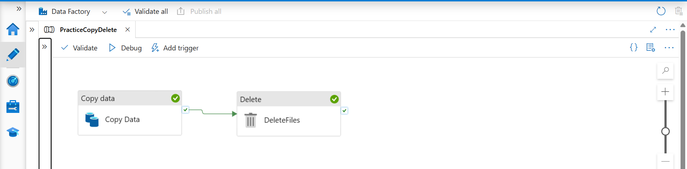
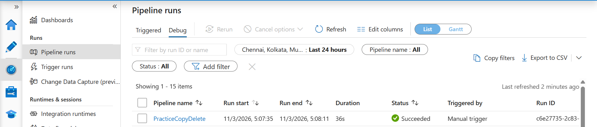
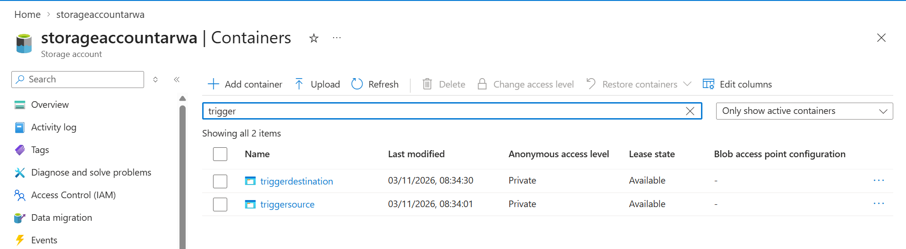
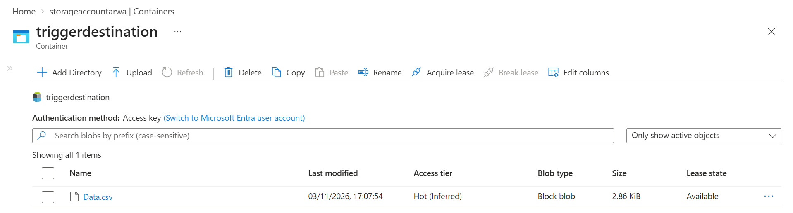

# ADF Practice: Copy a File, Then Delete the Source

My first Azure Data Factory (ADF) pipeline. It copies a CSV file from one Azure Data Lake Storage Gen2 container to another, and **deletes the original only if the copy succeeded**.



## The idea in plain words

It works like "cut and paste" on your computer: first copy the file to the new place, and only once that worked, remove it from the old place. If the copy fails, the delete never runs, so you can't lose the file.

## What it does

```
Copy Data  ──(on success)──►  DeleteFiles
```

1. **Copy Data** copies `Data.csv` from the `triggersource` container to the `triggerdestination` container.
2. **DeleteFiles** (a Delete activity) removes `Data.csv` from `triggersource`. It is linked to Copy Data with a green **On success** arrow, so it only runs after a successful copy.

## Components

| Component | Details |
|---|---|
| Pipeline | `PracticeCopyDelete` |
| Activities | `Copy Data` (Copy), `DeleteFiles` (Delete) |
| Source dataset | `DatasetPointingData_csv` |
| Sink dataset | `SinkPointingData_csv` |
| Storage | Azure Data Lake Storage Gen2 |
| Containers | `triggersource` (source), `triggerdestination` (destination) |
| Test file | `Data.csv` |
| File format | DelimitedText (CSV) |

The Delete activity reuses the **source** dataset (`DatasetPointingData_csv`), which is how it knows which file to remove.

## How to recreate it

1. Create a Data Lake Storage Gen2 account with two containers: `triggersource` and `triggerdestination`. Upload `Data.csv` to `triggersource`.
2. In ADF, create a linked service for the storage account.
3. Create a source dataset (DelimitedText) pointing to `Data.csv` in `triggersource`, and a sink dataset pointing to `triggerdestination`.
4. Create a pipeline and add a **Copy data** activity using those two datasets.
5. Add a **Delete** activity and select the source dataset.
6. Drag the green **On success** arrow from Copy data to Delete.
7. Click **Publish all**, then **Debug**, and check the **Output** tab.

## Result

After a successful run, `Data.csv` appears in `triggerdestination` and is removed from `triggersource`.

**Pipeline run output**



**Containers in the storage account**



**`Data.csv` in the destination container**



> **Running it again:** the Delete activity removes `Data.csv` from `triggersource`, so upload it again before the next run. Otherwise the copy step has nothing to copy.

## What I learned

- Copy Data and Delete activities
- Linking activities with the **On success** dependency
- Linked services and datasets
- Running and checking a pipeline with Debug and the Output tab

## What's next

This pipeline is run manually. The same containers are used in my next project, which adds a storage event trigger and a ForEach loop: [ADF-Storage-Event-Driven-File-Ingestion](https://github.com/arwak-codes/ADF-Storage-Event-Driven-File-Ingestion).

## Project files

```
pipeline/
└── PracticeCopyDelete.json
images/
```
